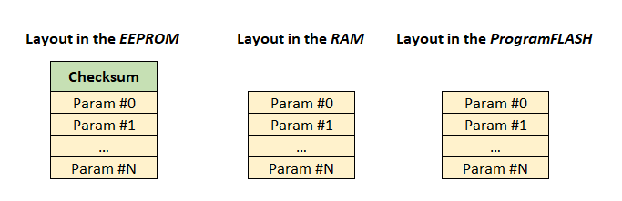
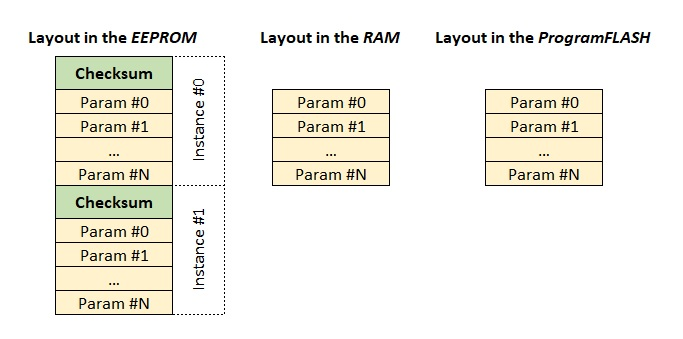
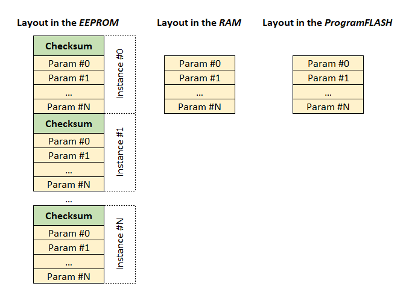
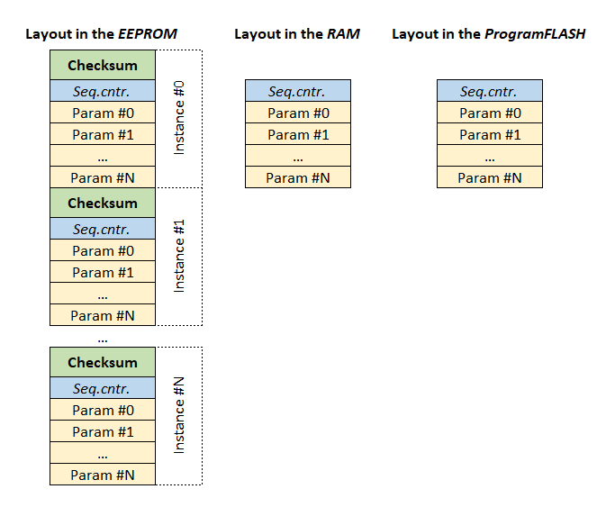
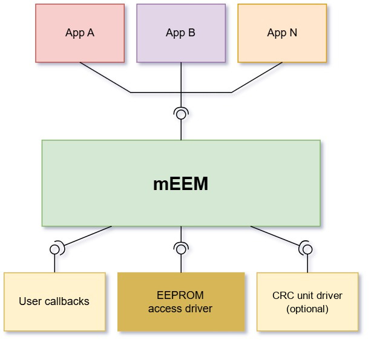

# Principle of operation
## Preface
Today's EEPROMs have 3 distinct features:  
- Write operations take *a lot* of time (several milliseconds)  
- Write operations don't stall the CPU (well, with some extremely rare exceptions among on-chip EEPROMs on some MCUs)  
- They can't be read while being written  

## Concept
- Treatment of all EEPROMs as serial devices.  
- Guaranteed non-concurrent read and write operations.  
- Centralized management of all EEPROM data.     
- Separate contexts for distinct application concerns (i.e. `blocks`, see below).  
- *Parameter*s as basic data units, provided to applications, with any primitive scalar type in [C99](https://en.wikipedia.org/wiki/C99), or array of them.  
- Multiple *parameters* organized into *blocks*.  
- Static EEPROM partitioning with fixed addresses, known at compile time.  
- Distinct EEPROM management types for *blocks*, based on use case and expected write frequency: 

| Block management type | Use case                                                                       | Expected write frequency |
| --------------------- | ------------------------------------------------------------------------------ | ------------------------ |
| *Basic*               | For general use                                                                | Low to moderate          |
| *BackupCopy*          | Data with enhanced reliability                                                 | Low                      |
| *MultiProfile*        | Multiple parameter sets of the same type (*user profiles*), switchable runtime | Low to moderate          |
| *Wear-leveling*       | Frequently changed data                                                        | High                     |

#### What does *low*, *moderate* and *high* write frequency mean?

| Write frequency | Number of writes per block per power cycle, on average |
| --------------- | ------------------------------------------------------ |
| Low             | Less than 1                                            |
| Moderate        | Up to 10                                               |
| High            | At least 10                                            |

- By `data`, we'll understand a *collection of all parameters within a block*.

## Block memory layout and management types
- A block has instances in 3 types of memory: *EEPROM*, *RAM* (data cache) and *Program FLASH* (default values). Each memory area is contiguous.
- A block has a variable number of data instances in EEPROM, depending on its management type. Each instance features a `checksum`, prepended to the `data`. The `checksum` is a CRC-16/IBM-3740 calculated over the data: 2 bytes for every block, in the target's byte order. An instance of all `0x00` or all `0xFF` bytes never passes it, so a blank or zeroed EEPROM area is never taken for data.
- A block has a single instance of data in the RAM.
- A block has a single instance of data in the Program FLASH memory. To save memory, the *mEEM* may try to deduce the shortest possible pattern from default values you've defined in the [*EEPROM data model*](../README.md#18). In some scenarios, that may yield substantial savings. Pattern deduction is a configurable option.  
  For simplicity, the following diagrams illustrate the full (non-compressed) layout of defaults.

### Basic
These blocks have the smallest memory footprint and usually are default choice.  


### BackupCopy
These blocks have double the EEPROM footprint, compared to *Basic* blocks, but that's the price for the enhanced reliability. Use such blocks for storage of rarely changed data.  
On initialization, *always both* EEPROM instances are read and validated.  
On write, *always both* EEPROM instances are written.  

                                                      
### Multi-profile
With these blocks, only one EEPROM instance (i.e. the `active profile`) can be used at a time, just like a *Basic* block, but the instance is selectable at runtime.  
If the `active profile` needs to be switched, a wait is required (while the new instance is being fetched). The block is unusable during the switch-over.  
On initialization, the user is required to provide an ID of the initially selected profile via [callback](../src/required_interface/MEEM_UserCallbacks.h#29).  
On write, only the `active profile` is written to the EEPROM. A write requested before a switch-over is completed first, so it still goes to the previously active profile.  


### Wear-leveling
As their name suggests, these blocks distribute the EEPROM wear within their managed area by performing each write to a different EEPROM instance.  
The underlying implementation is a [circular buffer](https://en.wikipedia.org/wiki/Circular_buffer), and they feature a `sequence counter` (`Seq.cntr.` in the diagram below) - it is used to identify the most recently written instance.  
The `sequence counter` has a fixed size of 1 byte and is considered part of the `data` - it's also included in the checksum calculation.  
On initialization, *all* EEPROM instances are read and validated. When the most recent valid one is found, it is used to initialize the cache.  
On each write, the `sequence counter` is pre-incremented.  


## EEPROM layout
```
 0      6
 ┌──────┬─────────┬─────────┬─────┬─────────┬─────┬────────┐
 │ IDH  │ Block 0 │ Block 1 │ pad │ Block 2 │ ... │ unused │
 └──────┴─────────┴─────────┴─────┴─────────┴─────┴────────┘
 IDH = identity header, pad = padding before a page-aligned block
```
- The blocks follow the identity header in definition order. A page-aligned block starts at the next page boundary, so if the first block is page-aligned, the header takes up a whole page.
- The `identity header` is 6 bytes at offset 0: a CRC-16 (2 bytes), then the `EEPROM layout identity` (4 bytes), both little-endian on every target. The firmware doesn't evaluate the CRC-16: it compares the 6 stored bytes with generated constants. The CRC-16 lets the tools tell the intact header of another data model from garbage.
- The `EEPROM layout identity` is a hash of the target's endianness and of every block with its offset. For a block, it covers the name, the management type, the instance count, and the names, types and order of its parameters and bitfields.  
  So it changes with every change that moves or reshapes a byte, and doesn't change with default values, descriptions, `compress_defaults` or the data recovery strategy, which don't touch the stored data.
- `MEEM_EEPROM_LAYOUT_IDENTITY` gives it to the application. The [configurator](../tools/configurator/README.md) and the [inspector](../tools/eeprom_inspector/README.md) show it too.

## Initialization
`MEEM_Init()` first reads the identity header, and compares it:

| Stored header | What happens |
| --- | --- |
| The current data model's | Every block is read and validated, as described above. An invalid block gets its default values and is `recovered` according to its data recovery strategy. |
| The header of a legacy model: a data model of an earlier release, given to [the generator](./Configuration.md#4-give-the-generator-your-earlier-releases) | [Migration](#migration) |
| Anything else: blank, zeroed or corrupted, the image of *mEEM* v1, a data model the generator didn't get | [Reset](#reset) |

If the EEPROM driver reports a failure while reading the header, every block is read and validated as usual and the header is left alone. Blocks that don't fit fail their checks.

### Reset
Nothing is read. Every block gets its default values and the status `recovered`, and multi-profile blocks select their active profile as usual. `MEEM_OnBlockInitComplete()` is called for every block. Then `MEEM_PeriodicTask()` [rewrites](#rewrites-and-the-commit) every block and writes the header.  
This is also what the very first start of a device does, with a blank EEPROM.

### Migration
Each block is compared with the block of the same name in the legacy model. The generator has already done that, so the firmware only reads the outcome from a table:

| Block | Its cache gets | Its status | Rewrite |
| --- | --- | --- | --- |
| Unchanged, at the same place | Its data, read and validated as usual | As usual | No |
| Same parameters: it moved, or its instance count or management type changed | Default values, then its data, copied by the core | `migrated` | Yes |
| Other parameters | Default values, then its data, converted by a generated routine | `migrated` | Yes |
| No source, or the source has no valid instance | Default values | `recovered` | Yes |

[Here](./Configuration.md#4-give-the-generator-your-earlier-releases) is what each change of a data model does to the data.

All of this only reads, so no old data is overwritten before it's in a cache. The exception is a multi-profile block that was a multi-profile block in the legacy model too, and moved or changed: only the active profile fits the cache, so `MEEM_Init()` migrates and writes it profile by profile, after every other block, in an order that the generator found safe:
- It lengthens `MEEM_Init()` by the write time of these profiles.
- These writes call no write callback and leave `write_complete` clear. A failed one sets `write_failed`.
- `MEEM_OnBlockInitComplete()` and `MEEM_SelectInitiallyActiveProfile()` come in this order too, so these blocks are the last ones.
- The block needs no rewrite.

### Rewrites and the commit
After a reset or a migration, `MEEM_PeriodicTask()` writes the caches back while the application runs. A rewrite is one write operation that covers every instance of the block, whatever its data recovery strategy, because the new place may hold leftovers of the old layout that would pass their checks:

| Management type | Instances written |
| --- | --- |
| Basic | The single instance |
| BackupCopy | Both copies |
| WearLeveling | All instances, with sequence counters `0 ... n-1`. The next write goes to instance 0 with counter `n`. |
| MultiProfile | Every profile, with the same content |

What the application sees:
- Rewrites call `MEEM_OnBlockWriteStarted()` and `MEEM_OnBlockWriteComplete()` and set `write_complete`, although the application didn't request them.
- While a block's rewrite is pending, `MEEM_InitiateBlockWrite()` for that block returns false. The rewrite stores the cache as it is when the rewrite starts, so changes made before then are stored with it.
- A switch to another profile is accepted while a rewrite is pending: the rewrite goes first, and the fetch loads the rewritten profile.

The identity header is written last, which commits the reset or the migration:
- `MEEM_IsBusy()` stays true until then, and `MEEM_Suspend()` doesn't stop the rewrites or the header write.
- `MEEM_DeInit()` drops a pending commit, like any pending write. **Call it only when `MEEM_IsBusy()` returns false**, otherwise the next `MEEM_Init()` repeats the migration or the reset.

### When things go wrong
A reset or a migration isn't protected against a power cut:

| Situation | Outcome |
| --- | --- |
| Power cut during a reset | The header is still invalid, so the next init resets again. There was no data to lose. |
| Power cut during a migration, before the header is written | The header still names the legacy model, so the next init migrates again. Old places that were already overwritten fail their checks, and those blocks get their default values. Each overwritten instance still passes with a chance of 1/65536, and then wrong data is migrated. |
| Power cut during the header write | A torn header matches no data model, so the next init resets every block, including the unchanged ones. |
| A rewrite fails | `write_failed`, and the header is still written. At the next init, the block most likely fails its check and is recovered according to its data recovery strategy. |
| The header write fails | The header stays as it was, so the next init repeats the migration or the reset. |
| A firmware downgrade, or a release that the generator wasn't given | The header is unknown: reset. |

## Runtime management
- *Blocks* are initialized in definition order from the `EEPROM-data-model.json`. Default values will be loaded into the block's cache if the EEPROM data is found to be invalid.    
- Pending write and/or fetch requests and [rewrites](#rewrites-and-the-commit) are processed in round-robin manner.  
- *Block*'s data is always written and read together, at once.  

## API
The following diagram closely illustrates the content of the [src](../src/) folder.  
Above the **mEEM** are the client components, that use the *provided interface*: [MEEM.h](../src/provided_interface/MEEM.h)  
Below the **mEEM** are the components, implementing the *required interface*: [MEEM_UserCallbacks.h](../src/required_interface/MEEM_UserCallbacks.h), [MEEM_EEAIF.h](../src/required_interface/MEEM_EEAIF.h) and, only if [the checksum is calculated by the MCU's CRC unit](./Configuration.md#5-choose-how-the-checksum-is-calculated), [MEEM_CRCIF.h](../src/required_interface/MEEM_CRCIF.h)  


## "A picture is worth a thousand words"
Refer to [the complete example](../example/Microchip/) to understand how all this works in practice.

## Notes on the EEPROM access driver
The robustness of the **mEEM** depends heavily on the used EEPROM access driver. A well-designed driver is expected to:  
- Return `NotOk` status only if something _really_ goes wrong.  
If a read/write failure occurs, several retries (usually 2-3) should be made before returning `NotOk`. This is _a must_ for external serial EEPROMs.  
- Perform difference check with the actual EEPROM content, before each requested _write_ operation.  
While this technique will greatly reduce the EEPROM wear-out, it will incur runtime overhead, especially with external serial EEPROMs. Although, it would be completely justified for write-intensive applications.  
